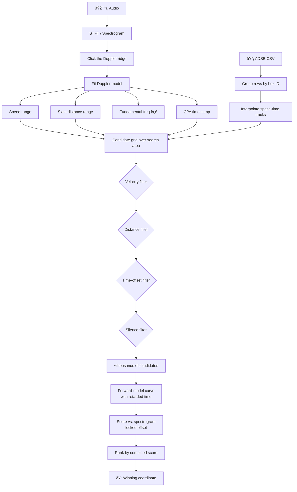
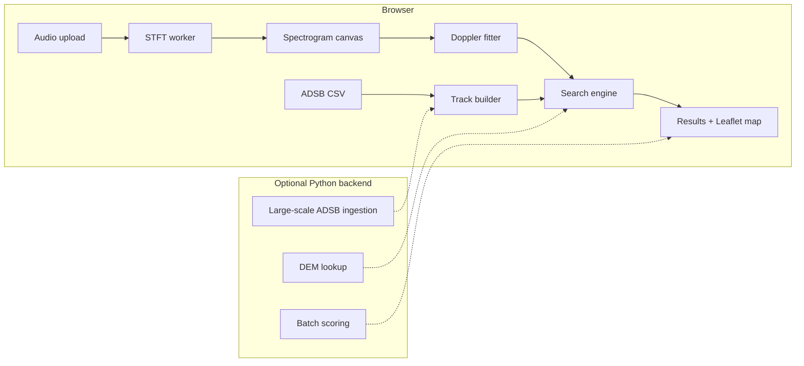

<!-- Header -->
<div align="center">

# 🛰️ Doppler Geolocator

### Locate a recording from aircraft Doppler signatures & open ADSB data

*Every flyover leaves a fingerprint. This tool reads it.*

[](https://opensource.org/licenses/MIT)
[](https://developer.mozilla.org/en-US/docs/Web/JavaScript)
[](#-quick-start)
[](CONTRIBUTING.md)
[]()

[Quick Start](#-quick-start) · [How It Works](#-how-it-works) · [Roadmap](#-roadmap) · [Limitations](#-honest-limitations) · [Contributing](#-contributing)

</div>

---

<div align="center">

> *"When you hear a plane fly over, you're probably in the only place on Earth hearing that exact curve."*

</div>

---

## 📖 Table of Contents

- [What is this?](#-what-is-this)
- [Demo](#-demo)
- [Features](#-features)
- [How It Works](#-how-it-works)
- [Quick Start](#-quick-start)
- [Usage](#-usage)
- [Data Formats](#-data-formats)
- [Configuration](#-configuration)
- [Architecture](#-architecture)
- [Repository Structure](#-repository-structure)
- [Tech Stack](#-tech-stack)
- [Implementation Status](#-implementation-status)
- [Roadmap](#-roadmap)
- [Honest Limitations](#-honest-limitations)
- [Ethical Use](#-ethical-use)
- [Contributing](#-contributing)
- [Acknowledgments](#-acknowledgments)
- [License](#-license)

---

## 🎯 What is this?

**Doppler Geolocator** is an open-source implementation of a geolocation technique that turns a faint, *inaudible* Doppler curve in a recording into a GPS coordinate.

A plane flying overhead shifts the pitch of its engine — a **Doppler curve** — and the exact shape of that curve encodes the plane's **speed** and its **closest distance** to the microphone. Combine that with public **ADSB** flight-tracking data, and you can compute exactly where the microphone must have been.

No visual landmarks. No metadata. No GPS. Just the hum of a propeller.

<div align="center">

**Input:** 🎙️ ~1 minute of audio + 📡 a day of ADSB data + 🗺️ a rough search area

**Output:** 📍 a coordinate, usually within a few hundred feet

</div>

---

## 🎬 Demo

<div align="center">

*(Replace this with your own demo GIF / screenshot)*

``

</div>

---

## ✨ Features

- 🎧 **In-browser spectrogram** — STFT computation, zoomable time/frequency axes, click-to-measure
- 📐 **Doppler curve fitting** — nonlinear least squares with uncertainty bounds on speed, slant distance, and fundamental frequency
- 📡 **ADSB ingestion** — parse a day of flight-tracking CSVs into interpolated space-time tracks
- 🧮 **Candidate generation funnel** — velocity → distance → time-offset → silence filtering, in that order (cheapest to most expensive)
- 🌊 **Retarded-time forward model** — correctly models the emission-time delay so the predicted curve matches reality, not just approximately
- 🔒 **Locked-offset scoring** — prevents false positives by scoring both events against a geometry-derived time offset
- 🗺️ **Interactive Leaflet map** — visualize candidate grids, flight tracks, and the winning coordinate
- 🧩 **Single-event mode** — works with just one plane if the recording time is known
- 🧪 **Pluggable sound sources** — designed for thunder, sirens, trains, and church bells as well as aircraft (see [Roadmap](#-roadmap))

---

## ⚙️ How It Works

The pipeline is a funnel: each stage extracts information that eliminates more wrong answers than the last.



### The physics in one box

The Doppler equation for an observer hearing a source moving at radial velocity $v_r$:

$$f_{\text{obs}} = f_0 \cdot \frac{c}{c + v_r}$$

where $c$ is the speed of sound and $f_0$ is the source's fundamental frequency. The radial velocity is the component of the plane's velocity along the line-of-sight:

$$v_r(t) = \mathbf{v}(t) \cdot \frac{\mathbf{p}(t) - \mathbf{o}}{\lVert \mathbf{p}(t) - \mathbf{o} \rVert}$$

For a listener hearing a sound at time $t$, the sound was **emitted** at $t_{\text{emit}}$, where:

$$t = t_{\text{emit}} + \frac{r(t_{\text{emit}})}{c}$$

This **retarded-time** correction is the single most important subtlety — using the plane's velocity at the *received* time produces an entirely wrong curve, not just a delayed one. The forward model in this tool solves for $t_{\text{emit}}$ by fixed-point iteration.

### Stage summary

| Stage | What it does | Why it matters |
|---|---|---|
| **1. Spectrogram** | STFT of the audio → 2D time-frequency image | Makes the faint curve visible |
| **2. Curve fit** | Least-squares fit of the Doppler model | Extracts speed, distance, $f_0$, offset with bounds |
| **3. ADSB tracks** | Group + interpolate flight reports | Enables predicting what a listener *would* hear |
| **4. Funnel** | Velocity → distance → offset → silence filters | Collapses billions of points to thousands |
| **5. Forward model** | Predict curve from real geometry, with retarded time | Correct shape, not just approximate |
| **6. Locked scoring** | Sum spectrogram brightness under predicted curve | Final discriminator between candidates |
| **7. Rank** | Best point per flight-pair | The winner |

---

## 🚀 Quick Start

### Option A — Zero-install (single file)

```bash
git clone https://github.com/Abdullah-Chaudary/doppler-geolocator.git
cd doppler-geolocator/web
# just open it in your browser:
open index.html        # macOS
# or: xdg-open index.html   # Linux
# or: start index.html      # Windows
```

The entire web app is a single self-contained HTML file. No build step, no server, no dependencies beyond two CDN-hosted libraries (Leaflet + a spectrogram renderer).

### Option B — Local dev server

```bash
npx serve web
# or
python -m http.server 8000 --directory web
```

Then visit [http://localhost:8000](http://localhost:8000).

### Option C — Full pipeline (Python / Node)

*(Coming in v0.2 — see [Roadmap](#-roadmap).)*

```bash
pip install -r requirements.txt
python -m geolocator.cli --audio recording.wav --adsb day.csv --area area.geojson
```

---

## 🎓 Usage

### 1. Load the audio

Upload your recording in the **Audio** tab. Adjust FFT size and hop until the Doppler ridge is visible in the spectrogram. Zoom into the right frequency band and boost contrast if needed — the curve is often *inaudible* but visible.

### 2. Mark the curve

Click along the visible ridge to place measurement points. For two-event recordings, fit the first, click **Apply fit → Event 1**, then repeat for the second. You now have:

- A **speed range** (m/s)
- A **slant distance range** (m)
- A **fundamental frequency** $f_0$ (Hz)
- A **CPA timestamp** in the audio

### 3. Load the ADSB data

Upload a CSV in the **Flights** tab. The tool groups rows by aircraft ID, converts units, interpolates tracks, and shows them on the map.

### 4. Configure the search

In the **Search** tab:

- Draw a bounding box (or polygon) on the map
- Set grid resolution (default 200 m)
- Set hearing radius (default 10 km)
- Optionally enable the silence filter
- Enter the observed time offset between events (or let it derive from CPA timestamps)

### 5. Run and review

Click **Run search**. Watch the progress bar as the funnel narrows. Open the **Results** tab to see:

- A ranked table of candidates with event-1 and event-2 scores
- The winning coordinate dropped on the map
- Predicted-vs-actual curve overlays for the top candidates

### Library usage (JS)

```javascript
import { spectrogram, fitDoppler, searchCandidates } from 'doppler-geolocator';

const spec = await spectrogram(audioBuffer, { fftSize: 2048, hop: 512 });
const event = await fitDoppler(spec, clickedPoints);

const candidates = await searchCandidates({
  events: [event],
  flights: adsbTracks,
  area: searchPolygon,
  gridMeters: 200,
  hearingRadiusMeters: 10000,
});
```

---

## 📄 Data Formats

### ADSB CSV

The tool accepts a single CSV with one row per position report:

```csv
hex,timestamp,lat,lon,alt_ft,speed_kts
a1b2c3,1694120400,39.7392,-104.9903,12000,240
a1b2c3,1694120410,39.7410,-104.9951,12100,242
...
```

| Column | Meaning | Units |
|---|---|---|
| `hex` | Aircraft ICAO identifier | — |
| `timestamp` | Unix seconds (any consistent epoch) | s |
| `lat`, `lon` | WGS84 position | degrees |
| `alt_ft` | Barometric altitude (auto-detected feet > 1000) | ft |
| `speed_kts` | Ground speed | knots |

Rows sharing a `hex` become one flight track, ordered by timestamp.

### Audio

WAV, MP3, OGG, M4A — anything the Web Audio API can decode.

### Search area

A GeoJSON `Polygon` / `Feature` / `FeatureCollection`, or simply a bounding box drawn on the map.

---

## 🔧 Configuration

| Parameter | Default | Meaning |
|---|---|---|
| `fftSize` | 2048 | STFT window length (samples) |
| `hopSize` | 512 | STFT step (samples) |
| `gridMeters` | 200 | Candidate grid spacing |
| `refineGridMeters` | 100 | Sub-grid spacing for final scoring |
| `hearingRadiusMeters` | 10000 | Max distance a plane is assumed audible |
| `groundElevationMeters` | 0 | Assumed constant ground elevation (see roadmap) |
| `speedTolerance` | ±15% | Velocity filter tolerance |
| `distanceTolerance` | ±15% | Slant-distance filter tolerance |
| `offsetToleranceSec` | 5 | Time-offset filter tolerance |
| `fundamentalSweepHz` | ±2 | Sweep range for $f_0$ alignment |
| `timeSweepSec` | ±3 | Sweep range for event-1 temporal alignment |
| `topCandidatesToScore` | 500 | Cap on full forward-model scoring |

---

## 🏗️ Architecture



The web app runs entirely client-side. The optional Python backend (roadmap) handles the heavy industrial-scale pieces that don't fit in a browser tab — country-wide ADSB ingestion, DEM lookups, and batch curve scoring across tens of thousands of candidates.

---

## 📂 Repository Structure

```
doppler-geolocator/
├── web/
│   ├── index.html              # Single-file web app
│   ├── doppler.js              # Forward model + retarded-time solver
│   ├── spectrogram.js          # STFT + rendering
│   ├── search.js               # Candidate funnel + scoring
│   └── adsb.js                 # CSV parsing + track interpolation
├── python/                     # Optional pipeline (roadmap)
│   ├── geolocator/
│   │   ├── adsb.py
│   │   ├── dem.py
│   │   ├── doppler.py
│   │   ├── search.py
│   │   └── cli.py
│   └── requirements.txt
├── data/
│   ├── sample-adsb.csv         # Small demo dataset
│   └── sample-audio.wav        # Demo recording (synthetic)
├── docs/
│   ├── demo.gif
│   ├── methodology.md          # Deep-dive on the math
│   └── architecture.md
├── tests/
│   ├── test_doppler.js
│   ├── test_search.js
│   └── test_adsb.py
├── .github/
│   ├── workflows/
│   │   ├── ci.yml
│   │   └── deploy-pages.yml
│   ├── ISSUE_TEMPLATE/
│   └── PULL_REQUEST_TEMPLATE.md
├── CONTRIBUTING.md
├── CODE_OF_CONDUCT.md
├── SECURITY.md
├── LICENSE
└── README.md
```

---

## 🧰 Tech Stack

| Layer | Choice | Why |
|---|---|---|
| **Audio / DSP** | Web Audio API + custom STFT | Zero-dependency, runs everywhere |
| **Doppler math** | Vanilla JS (optimized) | Small enough to inline; fits in browser |
| **Map** | [Leaflet](https://leafletjs.com) | Tiny, extensible, OSM-tiled |
| **UI** | Plain HTML/CSS/JS | No framework tax; hackable |
| **Optional backend** | Python 3.11+ | ADSB + DEM + batch math ecosystem |
| **Tests** | Node test runner + pytest | Boring but reliable |
| **CI** | GitHub Actions | Build, test, deploy Pages |

---

## 📌 Implementation Status

This project is under active development. Here's what's real vs. planned:

| Component | Status |
|---|---|
| Spectrogram + click-to-measure | ✅ Working |
| Doppler curve fit (speed, distance, $f_0$, CPA) | ✅ Working |
| ADSB CSV ingestion + track interpolation | ✅ Working |
| Candidate funnel (velocity, distance, offset, silence) | ✅ Working |
| Retarded-time forward model | ✅ Working |
| Locked-offset scoring | ✅ Working |
| Leaflet map + result ranking | ✅ Working |
| Country-wide ADSB ingestion | 🚧 Roadmap (needs paid API + 50 GB-scale storage) |
| Real DEM ground elevation | 🚧 Roadmap |
| ICAO type-code prop/jet filter | 🚧 Roadmap |
| Thunder / siren / train source models | 🚧 Roadmap |
| CLI + Python backend | 🚧 Roadmap |
| 100 m full-US grid | 🚧 Roadmap (needs serious compute) |

The web app is a **fully functional implementation of the methodology** at the search-area scale (a city, a county, a drawn polygon). The roadmap items are the pieces that let it scale to "the whole continental US" without melting your laptop.

---

## 🗺️ Roadmap

- [ ] **v0.2** — CLI pipeline, DEM-based ground elevation, ICAO type-code filtering
- [ ] **v0.3** — Thunder-source model (uses lightning-strike networks for source position)
- [ ] **v0.4** — Global ADSB ingestion via [OpenSky Network](https://opensky-network.org/) or paid feed
- [ ] **v0.5** — Batch scoring at country scale (GPU / WASM)
- [ ] **v0.6** — Generic "known-positioned sound source" plugin API (sirens, trains, bells)
- [ ] **v1.0** — Reproduces the full end-to-end demo from the original video

Vote on priorities in [Discussions](https://github.com/Abdullah-Chaudary/doppler-geolocator/discussions).

---

## ⚠️ Honest Limitations

This tool is powerful, but it isn't magic. It fails — sometimes silently — in these cases:

- **No detectable plane in the recording.** Zero curves = zero events = no coordinate. The method narrows possibilities; it doesn't create evidence from nothing. Extend the audio window, try single-event mode with a known time, or switch to a different sound source.
- **A plane passed but was too far to hear.** Same as above. A more sensitive spectrogram may or may not rescue it.
- **Only jets, no props.** The velocity filter will reject them (or the curve will be too noisy to fit precisely).
- **Aggressive audio processing.** Phone compression survives (tested), high-pass filtering doesn't remove it (tested), but targeted notch filters can kill it.
- **Flat ground assumption.** The current web app uses a single ground elevation per search; a real DEM is on the roadmap. Mountainous terrain will introduce error.
- **Straight-line CPA model.** The fit assumes roughly constant velocity and heading near the CPA; a turning plane will fit poorly and widen your uncertainty bounds.
- **Small search areas only.** Browser memory caps what you can search in one pass.

The tool reports "no viable candidate" when the input contains no real signal. That's the correct output — not a bug.

---

## 🛡️ Ethical Use

This tool geolocates recordings. That's inherently dual-use. Please use it responsibly:

- **Use it for defense, research, journalism, and privacy awareness** — understanding that your recordings leak information is the first step toward protecting them.
- **Don't use it to stalk, harass, or deanonymize people without consent.**
- **Don't use it to identify the location of sensitive infrastructure, individuals' homes, or protected persons.**
- **If you publish results**, disclose your methodology and confidence intervals honestly. False precision is harm.
- **Read [SECURITY.md](SECURITY.md)** for vulnerability reporting.

The technique is public. The responsible thing is to understand it and to help people protect themselves, not to build weapons out of it. The original research framing is a good North Star: *"The odds that someone can and does actually do this is pretty slim. In reality, there's probably a hundred easier ways to find you than this."*

---

## 🤝 Contributing

Contributions are welcome — bug reports, methodology corrections, new source models, docs, and tests especially.

- Read [CONTRIBUTING.md](CONTRIBUTING.md)
- Read the [Code of Conduct](CODE_OF_CONDUCT.md)
- Check [good first issues](https://github.com/Abdullah-Chaudary/doppler-geolocator/labels/good%20first%20issue)
- Open an issue or a PR — small and focused is best
- For methodology changes, include a test or a reproducible example

```bash
# Fork, clone, then:
npm install           # web app dev deps
npm test              # JS tests
pytest                # Python tests (once v0.2 lands)
```

---

## 🙏 Acknowledgments

- The methodology and framing are directly inspired by the outstanding original research video that demonstrated the technique (retarded-time Doppler modeling, ADSB-driven candidate filtering, and locked-offset scoring are all from that work).
- [OpenSky Network](https://opensky-network.org/) for making ADSB data accessible
- [Leaflet](https://leafletjs.com) and [OpenStreetMap](https://www.openstreetmap.org) contributors
- Everyone who's written about the physics of moving-source Doppler — this is standing on a century of that work

---

## 📜 License

MIT © the contributors. See [LICENSE](LICENSE).

Do whatever you want with it — but use it responsibly.

---

<div align="center">

**If this project taught you something, give it a ⭐**

[](https://star-history.com/#Abdullah-Chaudary/doppler-geolocator&Date)

*Built with curiosity, FFTs, and a healthy respect for what a 20 Hz wobble can reveal.*

</div>